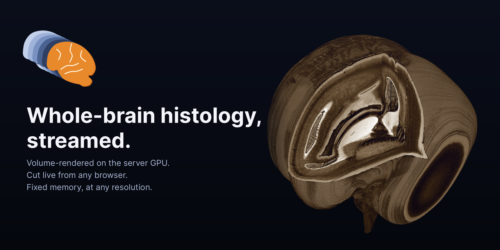
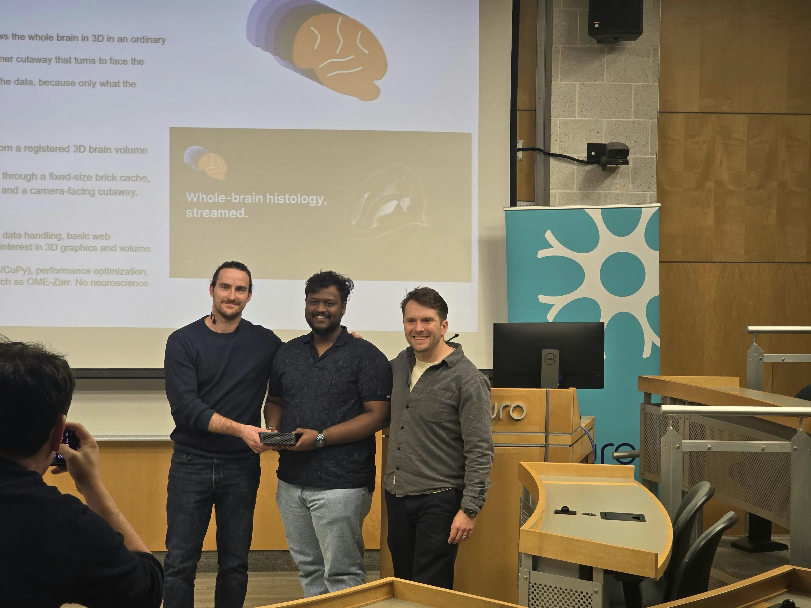

<p align="center">
  
</p>

<h1 align="center">Open the Mind</h1>

<p align="center">
  Streaming out-of-core visualisation of high-resolution 3D volumes.
</p>

<p align="center">
  🏆 Winning project of the <a href="https://tfunck.github.io/bigbrainhack2026/">BigBrain Hackathon 2026</a>
  (18–19 October 2026, The Neuro, Montréal).
</p>

<p align="center">
  
</p>

---

## BigBrain Hackathon 2026

Open the Mind was built at the [BigBrain Hackathon 2026](https://tfunck.github.io/bigbrainhack2026/), held on
18–19 October 2026 at The Neuro (Montreal Neurological Institute) just before the 10th BigBrain Workshop. It was
voted the winning project by the workshop participants, and won the hackathon's prize: a Dell Pro Max with NVIDIA
GB10.

<p align="center">
  
</p>
<p align="center">
  <em>Receiving the Dell Pro Max with NVIDIA GB10 from the organisers, Gregory Kiar and Thomas Funck.</em>
</p>

## The problem

Whole-brain histology at cellular resolution runs from terabytes to petabytes. Today's tools either show it as 2D
slices or load the whole volume into memory before rendering. Neither lets a researcher see the whole brain in 3D,
cut it open anywhere and zoom into the cut, from an ordinary browser.

This project builds a viewer for that. The browser shows one 3D view of the whole brain, and the user can:

- **cut it**: with three sliders that move x/y/z planes, or with a corner cutaway that turns to face the camera
  as the brain rotates;
- **zoom in**: the cut faces sharpen from the coarse overview down to the native resolution.

Rendering runs on the server GPU and the browser only receives frames. Memory stays fixed whatever the size of the
data: the unit of work and of memory is what the screen needs, never the whole volume.

## Goals

1. Build a multi-resolution brick pyramid from a registered 3D volume without loading it whole.
2. Render it on the server GPU through a fixed-size brick cache, with volume rendering, x/y/z cut planes and a
   camera-facing cutaway.
3. Stream frames to a browser page with sliders and orbit, pan and zoom, and keep memory flat as the resolution grows.

## Requirements

- Linux (or WSL2 on Windows) on a 64-bit x86 or ARM machine.
- An NVIDIA GPU of compute capability 7.5 or newer (GTX 16xx / RTX 20xx or later, data-centre GPUs from the T4
  on), with a driver that supports CUDA 12.6 or newer.
- Python 3.10 or newer, a C compiler and the Python headers (Triton builds a small launcher).
- About 2 GB of free RAM and 2 GB of free GPU memory. Nothing is loaded whole, so both can be far smaller than the
  data.
- Any modern browser on the viewing side.

Tested on an RTX 5060 laptop GPU (x86_64, CUDA 13), a GB10 / DGX Spark (aarch64, CUDA 13) and an A100 (x86_64,
CUDA 12.4).

## How it works

| Part | What it does |
|---|---|
| Pyramid | Reads the volume slab by slab, within a memory budget, and writes compressed, sharded bricks of 16 × 128 × 128 voxels as OME-Zarr 0.5. Levels halve the in-plane resolution until the pixel size matches the section spacing, then halve all three axes. Empty background bricks are not stored |
| Renderer | GPU ray casting in one fused Triton kernel: front-to-back compositing, early ray termination, empty-space skipping, cut planes as kernel arguments |
| Brick cache | A fixed GPU brick pool with a page table and least-recently-used eviction. Rays request missing bricks; a coarser level fills in while the fine bricks load |
| Streaming | JPEG frames encoded on the GPU (nvJPEG) and pushed over a WebSocket: low resolution while dragging, sharp when the view stops |
| Browser page | One 3D view, three cut planes, a camera-facing cutaway, orbit, pan and zoom, colour maps and windowing |

## Quick start

One command sets everything up on a public whole-brain dataset, the [BigBrain](https://bigbrainproject.org)
(Amunts et al., *Science* 2013), and starts the viewer:

```
git clone https://github.com/chrislinesamc/open-the-mind.git
cd open-the-mind
test/test.sh
```

The script:

1. prints the machine's specs (system, CPU, RAM, disk, GPU, driver);
2. checks that the machine can run the viewer, and stops with what to fix if not (for example no NVIDIA GPU, a GPU
   that is too old, or an old driver);
3. installs PyTorch built for this machine's driver and CPU, and `requirements.txt`, into `.venv`;
4. downloads the data;
5. converts it to a Zarr pyramid within 2 GB of RAM and 2 GB of GPU memory;
6. starts the viewer and prints its address, e.g. `http://localhost:1729/`.

Steps that are already done are skipped, so after an interruption just run it again. Three datasets are available:

| Command | Data | Download |
|---|---|---|
| `test/test.sh` (or `test/test.sh nifti`) | The whole brain as one 100 µm NIfTI volume (1392 × 1541 × 1209) | 0.6 GB |
| `test/test.sh png` | The whole brain as its 7,404 coronal PNG thumbnails (500 × 434 pixels, 20 µm apart) | 0.43 GB |
| `test/test.sh slab` | 64 full-resolution sections (6572 × 5711 pixels, 20 µm) from the middle of the brain | 0.9 GB |

**In Docker:** the viewer listens on all interfaces (`0.0.0.0`) by default, so inside a container it only needs the
GPU and the port passed through, e.g. `docker run --gpus all -p 1729:1729 ...`, then open `http://<docker host>:1729/`.
`BIND=127.0.0.1 test/test.sh` limits it to the local machine instead.

On an RTX 5060 laptop GPU, each converts in under a minute, and the viewer runs a 1080p camera flight at 60 fps in
1.5 GB of RAM and 1.4 GB of GPU memory. Settings such as the port and the memory budgets are environment variables,
listed at the top of `test/test.sh` (e.g. `PORT=8080 test/test.sh`).

In the browser, drag to orbit, shift-drag or right-drag to pan, use the wheel to zoom, and move the cut planes with
the sliders.

## Use your own data

The input is one registered 3D volume of 8-bit voxels. Each converter writes the dataset's config next to the
pyramid and builds it; `--mem-gb` caps the RAM and GPU memory it uses (each).

**A folder of section images**, one 8-bit grayscale PNG per section, numbered (e.g. `s0001.png`, `s0002.png`, …).
The numbering, image size and background (a white one is inverted so it becomes 0 and is not stored) are detected;
give the section spacing and pixel size:

```
python scripts/png_to_zarr.py data/my_sections data/my_brain.ome.zarr --section-um 20 --pixel-um 21.17 --mem-gb 2
```

**A NIfTI volume** (`.nii` or `.nii.gz`). It is streamed slice by slice, so it never has to fit in RAM. Data that is
not 8-bit is scaled to 0–255, a white background is inverted, and the volume is turned into upright coronal
sections when its axes follow the anatomical ones (`--orient none` keeps the stored order):

```
python scripts/nifti_to_zarr.py data/my_brain.nii.gz data/my_brain.ome.zarr --mem-gb 2
```

**A raw volume**: one `uint8` file in C order, shape (sections, rows, columns). Copy `configs/example_raw.json`, set
`raw`, `shape_kji` and `spacing_mm_kji`, then:

```
python pyramid/build_pyramid.py configs/my_brain.json data/my_brain.ome.zarr --mem-gb 2
```

Then start the viewer on the pyramid:

```
python server/app.py data/my_brain.ome.zarr 1729 0.0.0.0 --pool-gb 1 --host-gb 0.5
```

`--pool-gb` is the GPU brick pool and `--host-gb` the RAM cache of compressed bricks; larger values evict less
often. Level 0 of a pyramid is lossless, so `python scripts/export_raw.py data/my_brain.ome.zarr out.raw` writes the
volume back. Keep data in `data/`; it is not committed.

## Full-resolution BigBrain

The full BigBrain is 7,404 sections of 6572 × 5711 pixels at 20 µm: 60 GB of PNGs, 278 GB as voxels. The same tools
handle it; only the download and the build take longer:

```
python scripts/fetch_ftp_sections.py data/bigbrain20_png --workers 16           # resumable
python scripts/png_to_zarr.py data/bigbrain20_png data/bigbrain20_png.ome.zarr --section-um 20 --pixel-um 21.1667 --mem-gb 8
python server/app.py data/bigbrain20_png.ome.zarr 1729 0.0.0.0 --pool-gb 4
```

`configs/bigbrain20_png.json` is the matching config. Other BigBrain files are at
<https://ftp.bigbrainproject.org/bigbrain-ftp/>.

## Repository layout

```
configs/      dataset configs (examples)
data/         local data (not committed)
docs/         architecture slides; docs/brand holds the logo and banner
pyramid/      out-of-core pyramid builder
scripts/      converters and command-line utilities
server/       GPU renderer, brick cache, frame streaming
test/         one-command trial on BigBrain (test.sh)
tests/        correctness and memory-bound checks (pytest)
web/          browser page
```

## Notes

- **Memory:** nothing is loaded whole. The viewer's GPU memory is the brick pool plus about 0.9 GB, and its RAM a fixed cache of compressed bricks; the builder holds a few strips of rows at a time. See `server/README.md` and `pyramid/README.md`.
- **Speed:** a 1080p frame renders in a few milliseconds. A 138.5 GB raw volume builds in about 2.5 min into a 24.1 GB pyramid.
- **Proof of flat memory:** on the GB10, the same 30 s flight runs at 60 fps with GPU memory fixed at the pool size from 26 GB to 278 GB of data, even with a 4 GB pool (`scripts/stream_bench.py`, table in `server/README.md`).
- **Tests:** `python -m pytest tests/ -q` (synthetic data, no download needed).

## Feedback

Corrections, bug reports and suggestions are very welcome. Please open an issue at
<https://github.com/chrislinesamc/open-the-mind/issues>, with the output of `test/test.sh` (or the command that
failed) if something does not work.

## Credits and licence

Created by Chrisline Sam C. The logo is an original drawing and the banner is a render from the viewer.

Licensed under [CC BY-NC 4.0](https://creativecommons.org/licenses/by-nc/4.0/) (see `LICENSE.md`): free to use, share
and adapt for non-commercial purposes, with credit.
